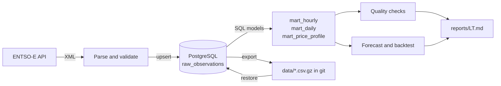

# Energy Data Pipeline

[](https://github.com/mantas123456/energy-data-pipeline/actions/workflows/ci.yml)
[](https://github.com/mantas123456/energy-data-pipeline/actions/workflows/daily.yml)

A small production-style data pipeline for Lithuania's electricity system. Every day it:

1. **Ingests** actual load, the TSO's day-ahead load forecast and day-ahead prices from the
   [ENTSO-E Transparency Platform](https://transparency.entsoe.eu) API
2. **Loads** them into PostgreSQL with idempotent upserts and a run log
3. **Transforms** them with SQL models into hourly, daily and price-profile tables
4. **Checks** data quality: freshness, gaps, plausible ranges, incomplete hours
5. **Forecasts** next-day load and backtests the model against the TSO's own forecast
6. **Publishes** the data and a report back to this repository

**Latest report: [reports/LT.md](reports/LT.md)**. It is regenerated daily by GitHub Actions
once the API key is configured.



## Design decisions

| Problem | How it is handled |
|---|---|
| ENTSO-E omits repeated values (curve type A03) | Parser fills omitted positions forward ([`entsoe.py`](src/energy_pipeline/entsoe.py)) |
| 15-minute and hourly series for the same hours (15-minute day-ahead market since Oct 2025) | Keep the finest resolution per timestamp; the upsert never lets coarser data overwrite finer data |
| Data gets revised after publication | The daily job re-fetches the last 7 days; upserts make reruns safe |
| Long backfills hit request limits | Requests split into 90-day chunks, with retry and backoff on 429 and 5xx |
| One failing series shouldn't block the others | Each series is loaded and logged separately in `ingest_runs`; the run fails at the end |
| GitHub Actions has no persistent database | Raw data is exported as yearly gzipped CSVs committed to `data/`. Each run restores PostgreSQL from them, then updates. Unchanged files are rewritten byte-identical, so git only records real changes. |
| Local time and daylight saving | Everything is stored in UTC. Daily marts use the zone's time zone from `dim_zone`, so DST days have 23 or 25 hours. |
| Forecast leakage | Features use load at least 48 hours old, which is what is known when a day-ahead forecast is made. A test checks this. |

## Data model

```
raw_observations   zone, series, ts_utc, resolution_min, value, ingested_at   (PK zone, series, ts_utc)
ingest_runs        one row per series per run: period, rows, status, error message
dim_zone           zone, EIC code, time zone
mart_hourly        zone, ts_hour, load_mw, tso_forecast_mw, price_eur_mwh, load_completeness
mart_daily         zone, local_date, energy_gwh, peak/min load, avg and load-weighted price,
                   negative-price hours, TSO forecast MAPE
mart_price_profile zone, month, local_hour, avg price
mart_forecast_*    backtest metrics and the next 48 hours of forecasts
```

SQL models are plain files in [`src/energy_pipeline/sql/`](src/energy_pipeline/sql), run in
name order.

## The forecasting question

The TSO forecasts tomorrow's load using weather forecasts. This model uses only calendar
features and load history: hour, weekday, season, Lithuanian public holidays, and 48-hour and
weekly lags. **How close can it get without weather, and on which days does weather matter?**
The report compares three methods over the last 8 weeks: the TSO forecast, this model, and
"same hour last week".

## Run it locally

Needs Python 3.10+, Docker (for PostgreSQL) and an ENTSO-E API key.

```bash
git clone https://github.com/mantas123456/energy-data-pipeline
cd energy-data-pipeline
pip install -e ".[dev]"
docker compose up -d                  # PostgreSQL on localhost:5432
cp .env.example .env                  # then paste your API key into .env

pipeline backfill --start 2024-01-01  # load history (a few minutes)
pipeline report                       # checks, forecast backtest, reports/LT.md
pipeline daily                        # what the scheduled job runs
pytest                                # unit tests; integration tests run if DATABASE_URL is set
```

On Windows, run the same commands in PowerShell or the VS Code terminal. `docker compose`
needs Docker Desktop. Without Docker, install PostgreSQL 16 and create a database and user
called `energy` and `pipeline`, or point `DATABASE_URL` at any PostgreSQL instance.

## Getting an API key

1. Register at [transparency.entsoe.eu](https://transparency.entsoe.eu).
2. Email transparency@entsoe.eu with the subject "Restful API access" and your account email
   in the body. Access is usually granted within a few working days.
3. In *My Account Settings*, generate a *Web API Security Token*.
4. Locally: put it in `.env`. On GitHub: Settings → Secrets and variables → Actions → New
   repository secret, named `ENTSOE_API_KEY`.
5. First run on GitHub: Actions → *Daily data refresh* → Run workflow, with
   `backfill_start` set to `2023-01-01`. After that it runs every day at 09:17 UTC.

## Adding a zone

Add it to [`config.yaml`](config.yaml) with its EIC code and time zone, for example Latvia
`10YLV-1001A00074` (Europe/Riga) or Estonia `10Y1001A1001A39I` (Europe/Tallinn), and adjust
the plausible load range.

## Tests

20 tests: XML parsing with fixtures for compressed curves, mixed resolutions and error
acknowledgements; request chunking with a fake HTTP session; and PostgreSQL integration
tests for idempotent upserts, the SQL marts, quality checks, the forecast, and the
export/restore round trip. CI runs them against a PostgreSQL 16 service container.

## How this was built

I designed the analysis and checked the results. I used Claude Code as
a coding assistant.

---
Mantas Valantinavičius · [github.com/mantas123456](https://github.com/mantas123456)
