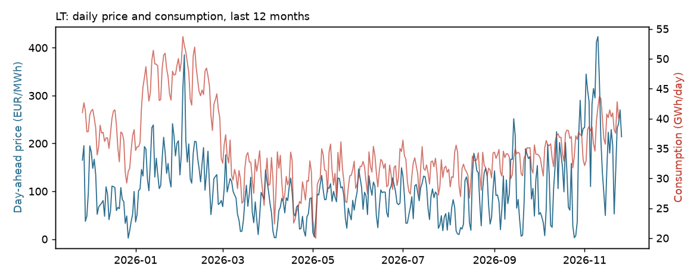

# LT electricity report

Updated 2026-11-24 20:14 UTC by the scheduled pipeline. Data: ENTSO-E Transparency Platform.

## Day-ahead load forecast, last 8 weeks

| method                      |   hours |   mae_mw |   mape_pct |   bias_mw |
|:----------------------------|--------:|---------:|-----------:|----------:|
| Model (no weather)          |    1344 |    69.15 |       4.4  |    -30.78 |
| Naive (same hour last week) |    1344 |    82.17 |       5.22 |    -32.68 |
| TSO day-ahead forecast      |    1344 |   104.22 |       6.8  |    -85.4  |

### Week by week

The table above averages over all backtest weeks. A forecast can come out ahead overall because of a few weeks where the other did badly, so check here whether the ranking holds week by week. Bias is forecast minus actual: negative means the forecast was too low.

| week_from   |   hours |   Model MAE (MW) |   Model MAPE (%) |   Model bias (MW) |   TSO MAE (MW) |   TSO MAPE (%) |   TSO bias (MW) |
|:------------|--------:|-----------------:|-----------------:|------------------:|---------------:|---------------:|----------------:|
| 2026-09-29  |     168 |             56.7 |              4.1 |              39.1 |          139.5 |            9.8 |          -136.7 |
| 2026-10-06  |     168 |             69.2 |              4.4 |             -60.8 |          203.2 |           13.3 |          -199.5 |
| 2026-10-13  |     168 |             80.2 |              5.1 |             -78.3 |          137.8 |            8.9 |          -116.6 |
| 2026-10-20  |     168 |             60.9 |              4.1 |               1.4 |          184.2 |           12.1 |          -177.1 |
| 2026-10-27  |     168 |             45   |              3   |             -17   |           58.4 |            3.9 |           -25.2 |
| 2026-11-03  |     168 |             82.7 |              5.1 |             -78.3 |           27.8 |            1.7 |            -3.8 |
| 2026-11-10  |     168 |            111.2 |              6.5 |             -62.4 |           54   |            3   |           -26.6 |
| 2026-11-17  |     168 |             47.3 |              2.8 |              10   |           28.8 |            1.7 |             2.4 |

## Last 7 days

| local_date   |   energy_gwh |   peak_load_mw |   avg_price_eur_mwh |   negative_price_hours |   tso_forecast_mape_pct |
|:-------------|-------------:|---------------:|--------------------:|-----------------------:|------------------------:|
| 2026-11-17   |         40.2 |         1931.3 |               223.5 |                      0 |                     2.9 |
| 2026-11-18   |         41.4 |         2000.7 |               179.8 |                      0 |                     0.9 |
| 2026-11-19   |         40.3 |         1922.1 |               229.1 |                      0 |                     1.3 |
| 2026-11-20   |         40.9 |         2001.6 |               196.4 |                      0 |                     2   |
| 2026-11-21   |         38.1 |         1864   |                52.7 |                      0 |                     1.9 |
| 2026-11-22   |         37.6 |         1859.5 |               138.9 |                      0 |                     1.2 |
| 2026-11-23   |         42.8 |         2065.9 |               232.1 |                      0 |                     1.4 |

## Data quality

Generated 2026-11-24 20:14 UTC

| Zone | Check | Result | Detail |
|---|---|---|---|
| LT | load is fresh | ✅ pass | latest actual load 2026-11-24 19:00 UTC (1 h old) |
| LT | no gaps in actual load | ✅ pass | 0 missing hours, longest gap 0 h (last 30 days) |
| LT | load within 100..5000 | ✅ pass | 0 of 719 hours outside range |
| LT | price within -500..4000 | ✅ pass | 0 of 746 hours outside range |
| LT | complete hours | ⚠️ warn | 2 hours built from incomplete sub-hourly data |
