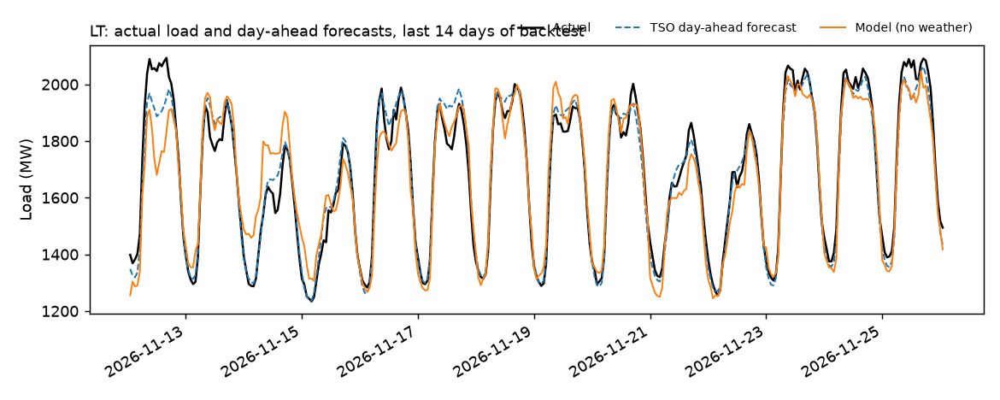

# LT electricity report

Updated 2026-11-26 19:07 UTC by the scheduled pipeline. Data: ENTSO-E Transparency Platform.

## Day-ahead load forecast, last 8 weeks

| method                      |   hours |   mae_mw |   mape_pct |   bias_mw |
|:----------------------------|--------:|---------:|-----------:|----------:|
| Model (no weather)          |    1344 |    64.01 |       4.04 |    -29.02 |
| Naive (same hour last week) |    1344 |    84.62 |       5.33 |    -37.94 |
| TSO day-ahead forecast      |    1344 |   102.84 |       6.69 |    -84.21 |

### Week by week

The table above averages over all backtest weeks. A forecast can come out ahead overall because of a few weeks where the other did badly, so check here whether the ranking holds week by week. Bias is forecast minus actual: negative means the forecast was too low.

| week_from   |   hours |   Model MAE (MW) |   Model MAPE (%) |   Model bias (MW) |   TSO MAE (MW) |   TSO MAPE (%) |   TSO bias (MW) |
|:------------|--------:|-----------------:|-----------------:|------------------:|---------------:|---------------:|----------------:|
| 2026-10-01  |     168 |             53.3 |              3.6 |              -7.1 |          180.6 |           12.2 |          -177.1 |
| 2026-10-08  |     168 |             75.6 |              4.8 |             -68.3 |          180.6 |           11.8 |          -177.1 |
| 2026-10-15  |     168 |             58.4 |              3.6 |             -47.7 |          161   |           10.3 |          -138.7 |
| 2026-10-22  |     168 |             55.9 |              4   |              26.3 |          150.4 |           10.1 |          -144.2 |
| 2026-10-29  |     168 |             50.4 |              3.3 |             -25.5 |           37.6 |            2.5 |            -0.3 |
| 2026-11-05  |     168 |             95.3 |              5.7 |             -90.2 |           44.8 |            2.6 |           -27.3 |
| 2026-11-12  |     168 |             75   |              4.5 |               3.9 |           36.7 |            2.1 |             9   |
| 2026-11-19  |     168 |             48.1 |              2.8 |             -23.6 |           31   |            1.8 |           -18   |

## Last 7 days

| local_date   |   energy_gwh |   peak_load_mw |   avg_price_eur_mwh |   negative_price_hours |   tso_forecast_mape_pct |
|:-------------|-------------:|---------------:|--------------------:|-----------------------:|------------------------:|
| 2026-11-19   |         40.3 |         1922.1 |               229.1 |                      0 |                     1.3 |
| 2026-11-20   |         40.9 |         2001.6 |               196.4 |                      0 |                     2   |
| 2026-11-21   |         38.1 |         1864   |                52.7 |                      0 |                     1.9 |
| 2026-11-22   |         37.6 |         1859.5 |               138.9 |                      0 |                     1.2 |
| 2026-11-23   |         42.8 |         2065.9 |               232.1 |                      0 |                     1.4 |
| 2026-11-24   |         43.2 |         2055.6 |               241.4 |                      0 |                     1.6 |
| 2026-11-25   |         44.1 |         2091.1 |               270.3 |                      0 |                     2.8 |

## Data quality

Generated 2026-11-26 19:07 UTC

| Zone | Check | Result | Detail |
|---|---|---|---|
| LT | load is fresh | ✅ pass | latest actual load 2026-11-26 18:00 UTC (1 h old) |
| LT | no gaps in actual load | ✅ pass | 0 missing hours, longest gap 0 h (last 30 days) |
| LT | load within 100..5000 | ✅ pass | 0 of 719 hours outside range |
| LT | price within -500..4000 | ✅ pass | 0 of 747 hours outside range |
| LT | complete hours | ⚠️ warn | 2 hours built from incomplete sub-hourly data |
