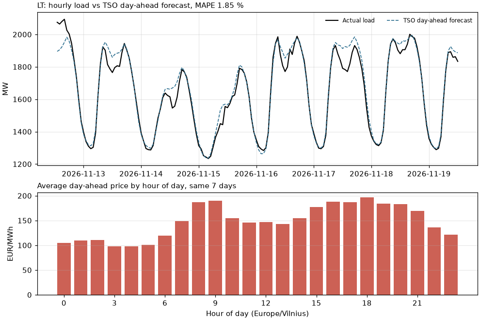

# LT weekly report

Period: 2026-11-12 13:00 to 2026-11-19 12:00 (Europe/Vilnius time), 168 hours. Generated 2026-11-19 11:37 UTC by the weekly workflow. Data: ENTSO-E Transparency Platform.

## TSO day-ahead load forecast

| Metric | Value |
|---|---|
| MAE | 32 MW |
| MAPE | 1.85 % |
| Hours compared | 168 of 168 |

Error of the TSO's published day-ahead forecast against actual load, hour by hour. Hours missing either value are left out.

## Data gaps

No missing hours in any series.

Hours with at least one series missing: 0 of 168. Hours with incomplete sub-hourly load data: 0.

## Day-ahead price

Average 148.1 EUR/MWh, lowest hour 15.9, highest hour 280.1, hours below zero: 0.

| Hour (Europe/Vilnius) | Average price (EUR/MWh) |
|---:|---:|
| 00:00 | 105.0 |
| 01:00 | 109.7 |
| 02:00 | 110.9 |
| 03:00 | 97.8 |
| 04:00 | 97.6 |
| 05:00 | 101.2 |
| 06:00 | 119.4 |
| 07:00 | 148.5 |
| 08:00 | 187.2 |
| 09:00 | 189.9 |
| 10:00 | 154.4 |
| 11:00 | 145.7 |
| 12:00 | 147.1 |
| 13:00 | 143.2 |
| 14:00 | 154.9 |
| 15:00 | 177.1 |
| 16:00 | 188.0 |
| 17:00 | 187.4 |
| 18:00 | 196.4 |
| 19:00 | 184.3 |
| 20:00 | 182.6 |
| 21:00 | 169.0 |
| 22:00 | 136.2 |
| 23:00 | 121.2 |
